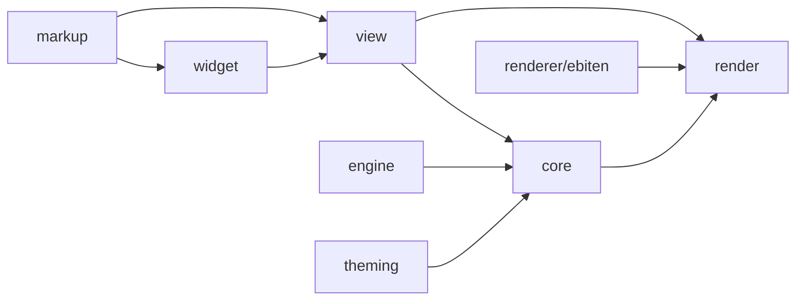

# Overview

`uitoolkit` is a Go GUI toolkit. It was extracted from gascoigne-workshop (which still uses it) and is being split into a renderer-agnostic toolkit plus renderer modules.

| Package | Role |
|---|---|
| `core` | tokens, colors, geometry, input, clipboard, fonts, `Ctx` drawing calls |
| `view` | element tree, flex layout, runtime, `Behavior`/`Custom` extension point |
| `widget` | components with their own drawing, input or state |
| `markup` | HTML-like templates that build `view` and `widget` trees |
| `theming` | JSON themes, palettes, high-contrast |
| `engine` | frame pacing, key bindings |
| `desktop/*` | OS probes: display scale, key repeat, file chooser, system info, fonts |
| `render`, `render/text`, `render/rendertest` | the renderer contract, a GPU-free font measurer, a recording fake |
| `renderer/ebiten` | the Ebitengine renderer, its own module (package `ebitenrender`) |
| `examples` | the widget `showcase`, its own module |

## Direction

No package of the root module imports Ebitengine: `core`, `view`, `widget`, `markup` and `engine` draw through `render`, and the Ebitengine renderer is the separate module `renderer/ebiten`. The queue in `tasks/` continues with a wgpu renderer (own FFI, no CGO) that can be embedded in another wgpu program. Order and reasons are in the task files.

## Where to change what

| Change | Where |
|---|---|
| a widget | `widget`: a composition of `view` elements, or a `view.Custom` behavior; options, tests, the package doc index and the markup tables (`CLAUDE.md`, API rules) |
| a primitive (color, geometry, drawing call) | `core` |
| a template attribute | `markup` (rule 9) |
| the look (a token, size, control style, widget look) | the code, `docs/ui-guidelines.md` in the same commit, and the goldens (`style.md`) |
